# عکس‌های مرجع کاما، شعبه بهشتی

بررسی در ۲۳ اکتبر ۲۰۲۶. این مجموعه شامل ۱۴ فایل رسمی است؛ چند تصویر، قاب یا نسخه متفاوت از یک عکس هستند. عکس‌های معماری، نمای خیابان، بنر و کاور جداگانه ثبت شده‌اند. تصاویر فقط مرجع پژوهش محلی‌اند و داخل public برنامه منتشر نشده‌اند.

منبع اصلی: [معرفی رسمی و گالری شعبه بهشتی](https://commaconcept.ir/about/). فهرست از صفحه معرفی و دو صفحه کتابخانه عمومی رسانه WordPress استخراج شد. فایل JSON کنار این سند، نشانی مستقیم و شرح هر تصویر را دارد.

## عکس‌ها

### official-01.jpg — منوی شعبه بهشتی

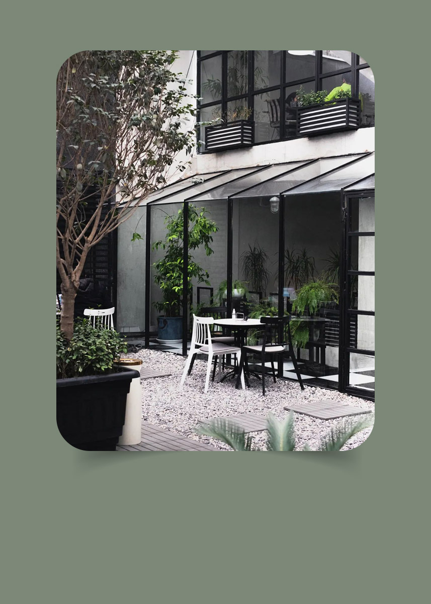

[فایل اصلی](https://commaconcept.ir/wp-content/uploads/2022/12/beheshti-comma-baner.jpg) · [صفحه منبع](https://commaconcept.ir/about/)

### official-02.jpg — محیط داخل کاما بهشتی

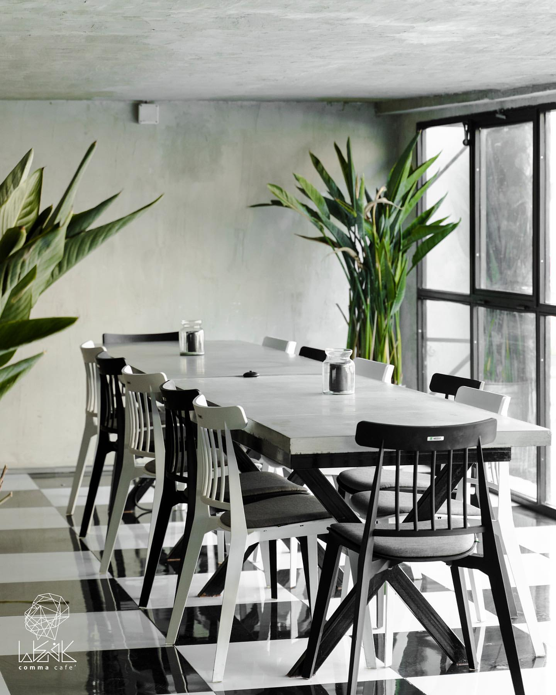

[فایل اصلی](https://commaconcept.ir/wp-content/uploads/2022/12/141288660_199599498564317_8356425358548250102_n.jpg) · [صفحه منبع](https://commaconcept.ir/about/)

### official-03.jpeg — حیاط بیرونی کاما بهشتی

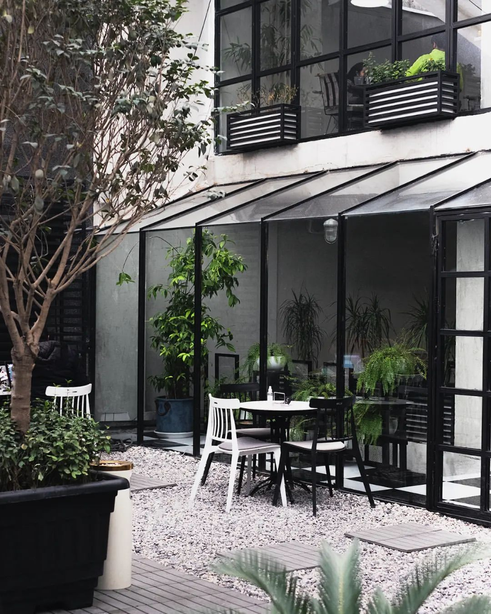

[فایل اصلی](https://commaconcept.ir/wp-content/uploads/2022/12/274092666_654583132445546_2400952724641021568_n.jpeg) · [صفحه منبع](https://commaconcept.ir/about/)

### official-04.jpg — محیط داخل کاما بهشتی

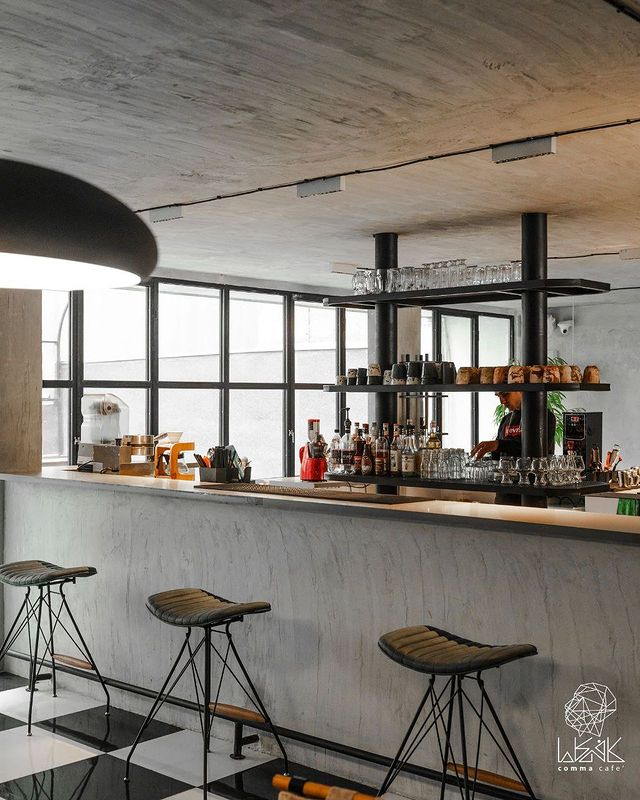

[فایل اصلی](https://commaconcept.ir/wp-content/uploads/2022/12/149845585_1112860042473242_1735638726872462953_n.jpg) · [صفحه منبع](https://commaconcept.ir/about/)

### official-05.jpg — فضای حیاط کاما بهشتی

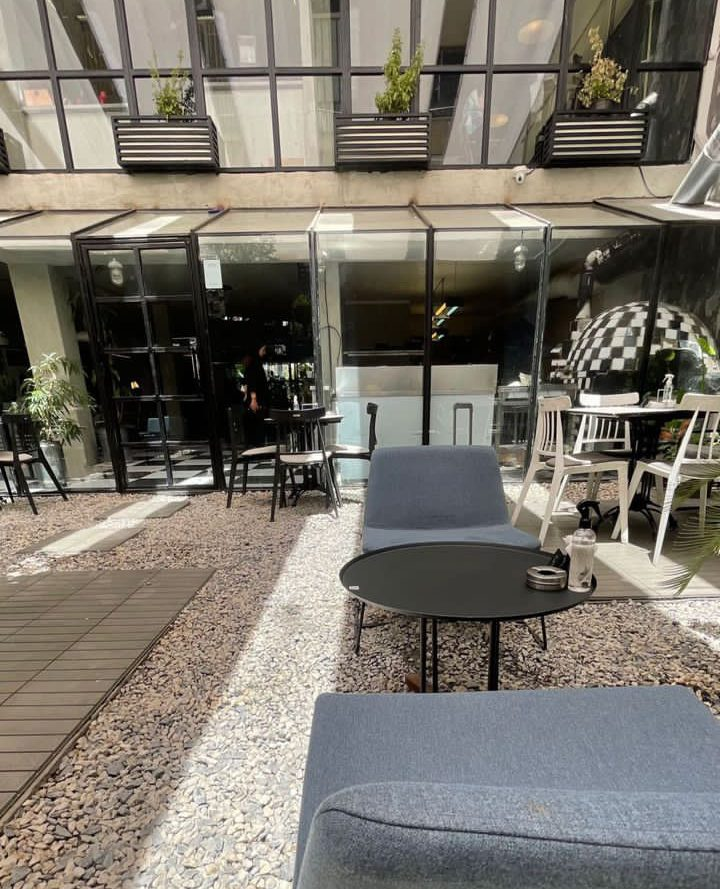

[فایل اصلی](https://commaconcept.ir/wp-content/uploads/2023/01/IMG_9079-e1673039469600.jpg) · [صفحه منبع](https://commaconcept.ir/about/)

### official-06.png — فضای داخل کاما بهشتی

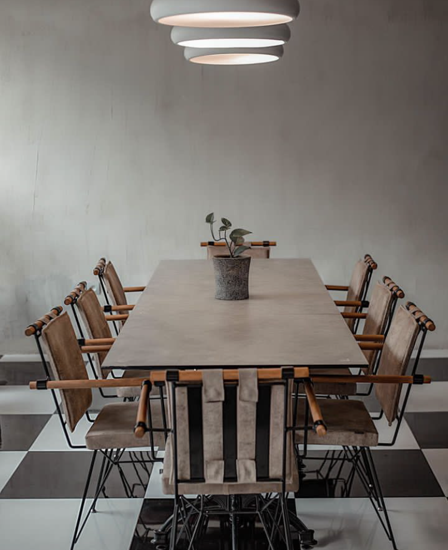

[فایل اصلی](https://commaconcept.ir/wp-content/uploads/2023/01/IMG_9074-e1673039494915.png) · [صفحه منبع](https://commaconcept.ir/about/)

### official-07.jpg — فضای حیاط کاما بهشتی

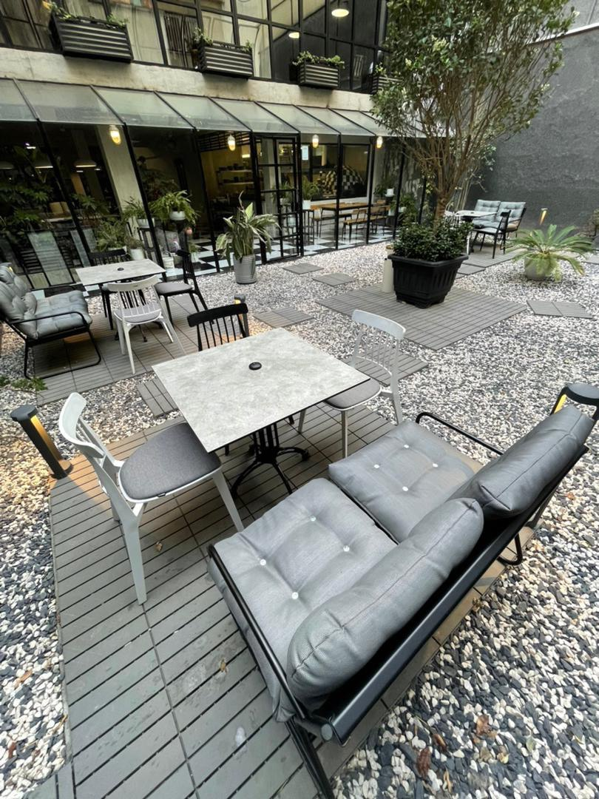

[فایل اصلی](https://commaconcept.ir/wp-content/uploads/2023/01/photo_2023-01-06_14-50-13.jpg) · [صفحه منبع](https://commaconcept.ir/about/)

### official-08.jpg — فضای داخل کاما بهشتی

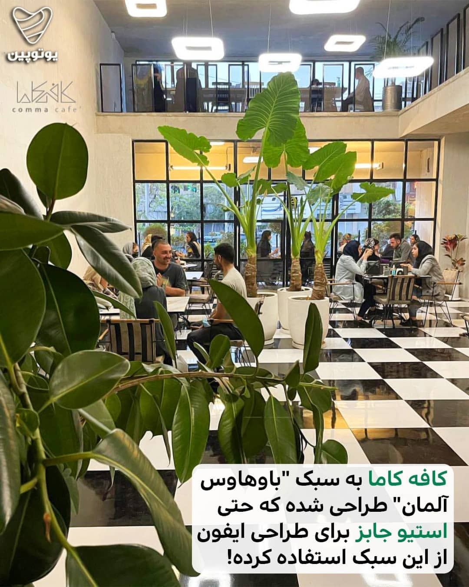

[فایل اصلی](https://commaconcept.ir/wp-content/uploads/2022/12/264875551_3305342919590101_9039763856113533836_n.jpg) · [صفحه منبع](https://commaconcept.ir/%da%a9%d8%a7%d9%81%d9%87-%d8%a2%d9%84%d9%85%d8%a7%d9%86%db%8c-%d8%af%d8%b1-%d8%aa%d9%87%d8%b1%d8%a7%d9%86/264875551_3305342919590101_9039763856113533836_n/)

### official-09.jpg — فضای داخل کاما بهشتی

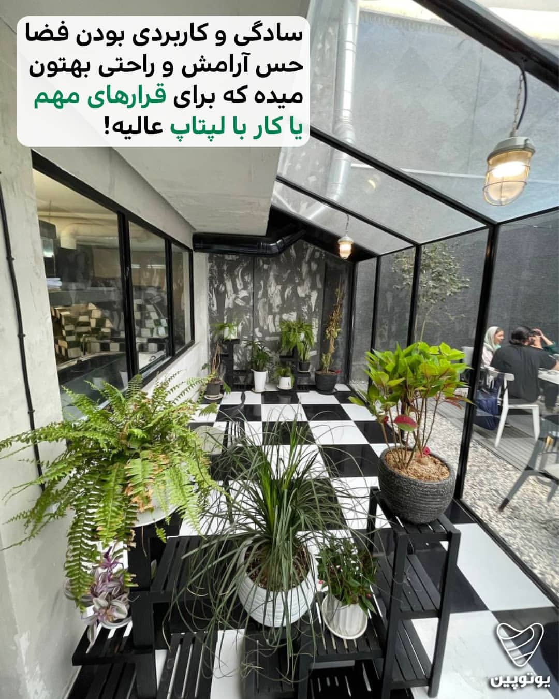

[فایل اصلی](https://commaconcept.ir/wp-content/uploads/2022/12/264711548_610270400396810_219836454183118005_n.jpg) · [صفحه منبع](https://commaconcept.ir/%da%a9%d8%a7%d9%81%d9%87-%d8%a2%d9%84%d9%85%d8%a7%d9%86%db%8c-%d8%af%d8%b1-%d8%aa%d9%87%d8%b1%d8%a7%d9%86/264711548_610270400396810_219836454183118005_n/)

### official-10.jpg — فضای بیرون کاما بهشتی

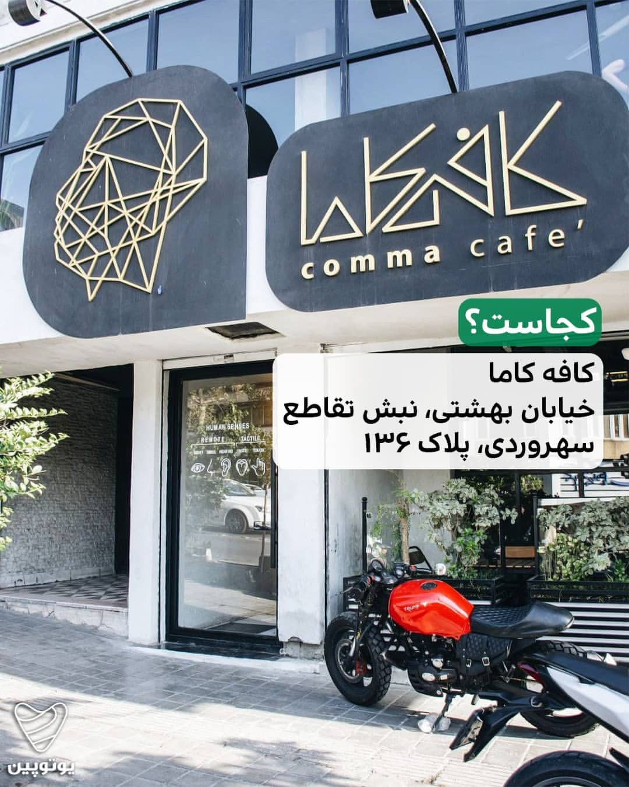

[فایل اصلی](https://commaconcept.ir/wp-content/uploads/2022/12/264414386_2810630859236416_1110939724260535032_n.jpg) · [صفحه منبع](https://commaconcept.ir/%da%a9%d8%a7%d9%81%d9%87-%d8%a2%d9%84%d9%85%d8%a7%d9%86%db%8c-%d8%af%d8%b1-%d8%aa%d9%87%d8%b1%d8%a7%d9%86/264414386_2810630859236416_1110939724260535032_n/)

### official-11.jpg — فضای داخل کاما بهشتی

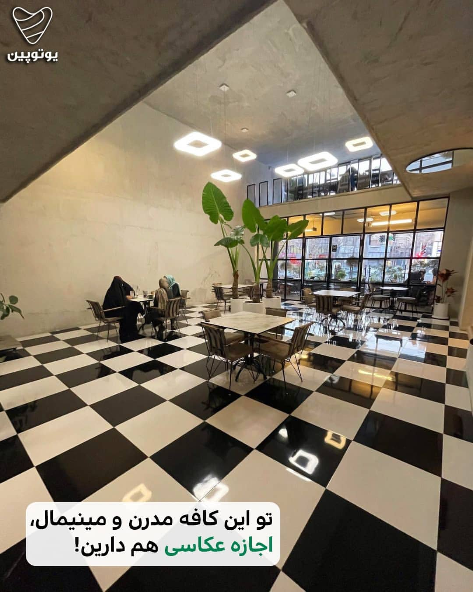

[فایل اصلی](https://commaconcept.ir/wp-content/uploads/2022/12/264242084_489646322633677_7357733806349867902_n.jpg) · [صفحه منبع](https://commaconcept.ir/%da%a9%d8%a7%d9%81%d9%87-%d8%a2%d9%84%d9%85%d8%a7%d9%86%db%8c-%d8%af%d8%b1-%d8%aa%d9%87%d8%b1%d8%a7%d9%86/264242084_489646322633677_7357733806349867902_n/)

### official-12.jpg — فضای حیاط کاما بهشتی

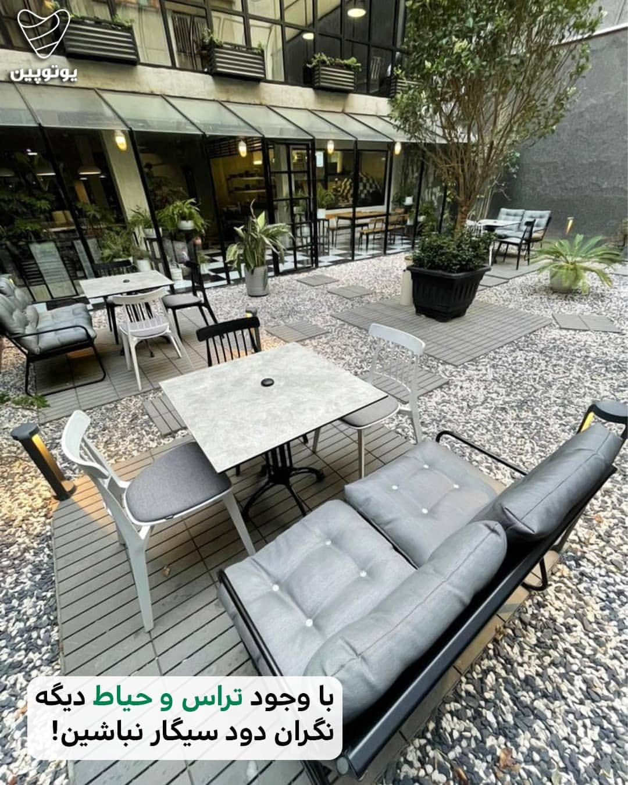

[فایل اصلی](https://commaconcept.ir/wp-content/uploads/2022/12/264193868_974502196832339_8647120563733890508_n.jpg) · [صفحه منبع](https://commaconcept.ir/%da%a9%d8%a7%d9%81%d9%87-%d8%a2%d9%84%d9%85%d8%a7%d9%86%db%8c-%d8%af%d8%b1-%d8%aa%d9%87%d8%b1%d8%a7%d9%86/264193868_974502196832339_8647120563733890508_n/)

### official-13.jpg — محیط داخل کاما بهشتی

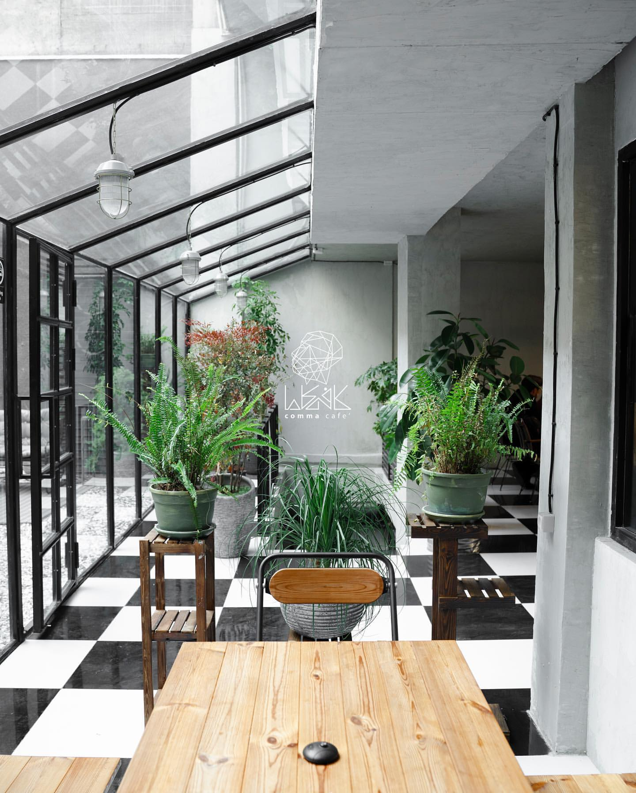

[فایل اصلی](https://commaconcept.ir/wp-content/uploads/2022/12/138807978_259129808891905_4624759629179731514_n.jpg) · [صفحه منبع](https://commaconcept.ir/138807978_259129808891905_4624759629179731514_n/)

### official-14.jpg — کاور ویدئو کافه رستوران کاما (شعبه بهشتی)

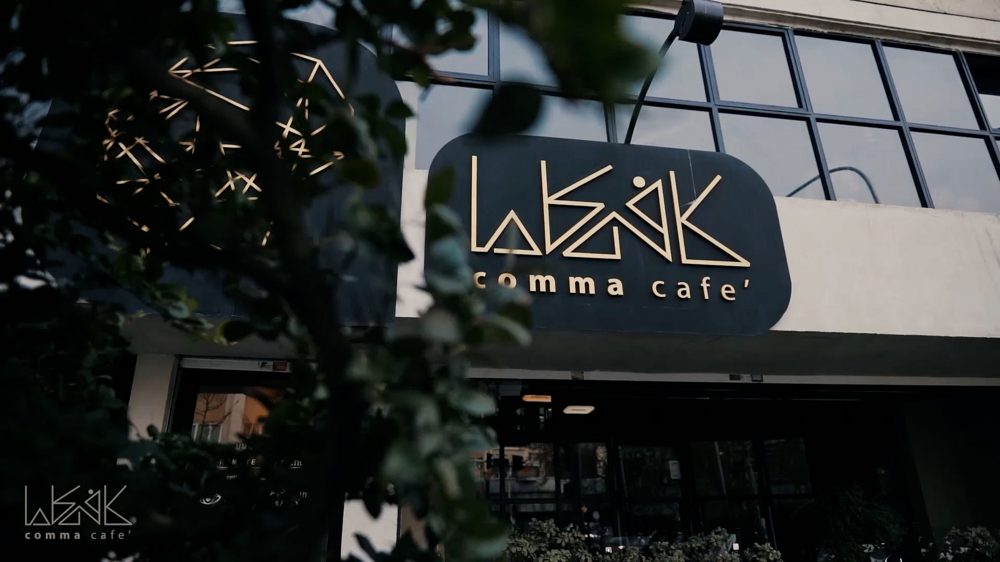

[فایل اصلی](https://commaconcept.ir/wp-content/uploads/2022/12/Cover-Video-About.jpg) · [صفحه منبع](https://commaconcept.ir/about/cover-video-about/)

## منابع تکمیلی بررسی‌شده

- [فودیسم، کاما بهشتی](https://foodism.app/place/کافه-کاما-بهشتی): شش لینک عکس پیدا شد؛ میزبان تصاویر در این محیط قابل دریافت نبود. از عکس‌های دریافت‌نشده برای مدل استنتاج نشده است.
- [Restaurant Guru](https://restaurantguru.com/Comma-Cafe-and-Resturant-Tehran): شعبه با شماره تماس تطبیق داشت؛ صفحه ۲۹ تصویر اعلام می‌کند، اما فایل‌های گالری از خروجی قابل دریافت نبود.
- [کافه باز](https://cofebaz.blogfa.com/): دو لینک عکس معرفی شعبه پیدا شد؛ میزبان عکس قابل دریافت نبود.
- [ویدیوی معرفی بهشتی](https://www.youtube.com/watch?v=qu8I3cnEs2U): لینک مرجع برای بررسی بعدی؛ ویدیو دریافت یا برای بازسازی تحلیل نشده است.
- نتایج شعب پاسداران، یوسف‌آباد، کافه‌های هم‌نام و تصاویر بدون انتساب روشن به بهشتی مبنای هندسه قرار نگرفتند.

## دقت بازسازی

مشاهده‌شده: کف شطرنجی، بتن اکسپوز، قاب‌های مشکی، سقف شیب‌دار گلخانه، گلدان‌های پنجره، حیاط با سنگ‌ریزه و کف‌پوش چوبی، درخت در گلدان مشکی شیاردار، مبل خاکستری، دو خانواده صندلی، بار بتنی با قفسه معلق، سالن دوارتفاع و نرده نیم‌طبقه.

متراژهای اعلام‌شده در سایت: هم‌کف ۳۰۰، طبقه اول ۱۵۰ و حیاط ۱۰۰ مترمربع. در مدل، عرض ۱۲٫۵ متر، عمق هم‌کف ۲۴ متر و عمق حیاط ۸ متر انتخاب شده تا با مساحت‌ها سازگار باشد؛ این نسبت‌ها اندازه‌برداری واقعی نیستند. نیم‌طبقه پیرامون یک فضای خالی ۱۰ × ۱۲٫۵ متر تخمین زده شده است.

نامشخص و تخمینی: شکل پلان، اتصال حیاط به سالن، ارتفاع‌ها، جای واقعی پله، بخش‌های خدماتی و محل و تعداد میزها. پله، آشپزخانه و VIP به دلیل نبود تصویر کافی بازسازی نشده‌اند. نیم‌طبقه در نمای کلی دیده می‌شود و مسیر پیاده فقط در هم‌کف و حیاط فعال است. میزهای قابل انتخاب، چیدمان نمایشی‌اند.

## اجرا و خروجی

- [مدل سه‌بعدی GLB](comma-beheshti.glb)، با سقف باز و متریال‌ها؛ نورپردازی به نمایشگر وابسته است.
- [بسته ۱۴ تصویر مرجع](reference-photos.zip)
- [رندر حیاط](renders/courtyard-day.png) · [رندر بار](renders/bar-day.png)

- صفحه محلی: `http://127.0.0.1:3000/cafe/comma-beheshti`
- کد هندسه: `apps/space/modules/explore/scenes/comma/cafe.js`
- چیدمان و مسیر: `apps/space/modules/explore/scenes/comma/layout.js`
- رندرهای مدل در `renders/` هستند. فایل GLB از دکمه دانلود در راهنمای گردش خروجی گرفته می‌شود.

حقوق عکس‌ها متعلق به صاحبان آن‌هاست. پیش‌نمایش داخل برنامه از رندر مدل ساخته شده است.